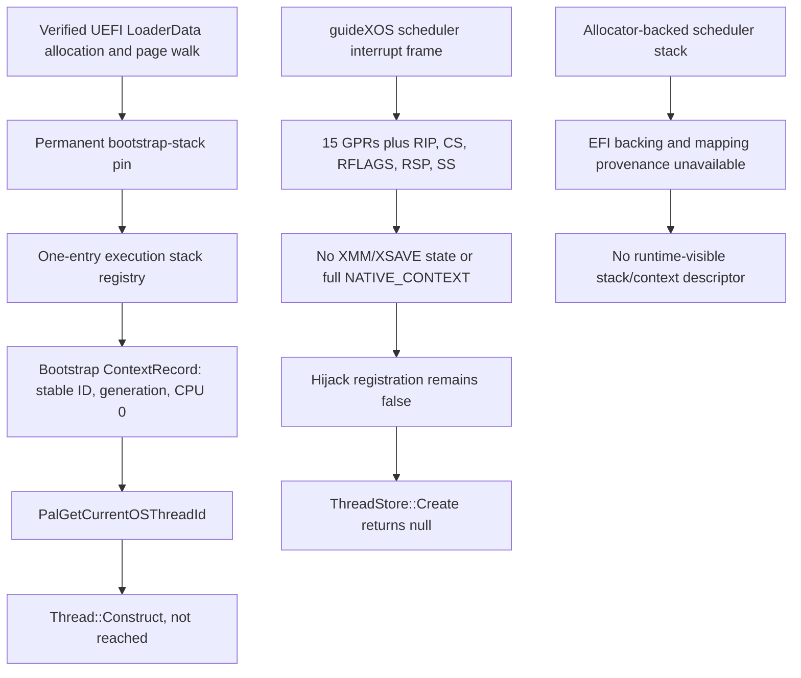

# P23R15 — Execution-Context PAL Foundation

**Outcome B — `P23R15_CONTEXT_FOUNDATION_PARTIAL`.** P23R15 adds a bounded execution-context contract, production scheduler-frame normalization, and a target PAL identity provider for the verified bootstrap stack. Hosted checks pass. The kernel still lacks allocator-backed stack provenance and complete NativeAOT context/suspension support; hijack callback registration remains fail-closed. The standard pinned-runtime link has 44 unresolved externals, so ThreadStore execution remains gated and Phase 23 remains blocked.

## 1. Repository state and provenance

- Checkout: `D:\dev\guideXOSUEFI_BUILD_INFRA`; branch: `BUILD_INFRA`.
- Starting HEAD: `1331528b455c6c35f04f8fcdaec110843d58d484` (`P23R14: fail closed on unsupported hijacking`). At the start the source worktree was clean and the branch was one commit ahead of `origin/BUILD_INFRA`.
- Ending HEAD: the local P23R15 commit on `BUILD_INFRA`. Its exact object ID is returned in the final execution summary because a commit cannot contain its own hash. It is not pushed.
- Pinned runtime revision: `9d5a6a9aa463d6d10b0b0ba6d5982cc82f363dc3`.
- The protected `out\rt` checkout remains at the pinned revision with the same 65 porcelain entries and ordered-status SHA-256 `41434BDE07D1EAA677C6B8E626CE63414012420506A160224DE2C18F144E813A` recorded by P23R14.
- `D:\dev\guideXOSUEFI_P23R8_RUNTIME_STAGING` remains at the pinned revision with the same 67 porcelain entries and ordered-status SHA-256 `2A122C605335703B8999F3FC6A7478888C73C5DAD200655929CAD8AA881CF25C` recorded by P23R14.
- `D:\dev\guideXOSUEFI_MODERN_INPUT` remains on `MODERN_INPUT`; its only status entries are the pre-existing untracked `_mi2-validation-20261028\` and `guideXOS\artifacts\` directories. No source changes from this phase remain there.
- Runtime source changes were applied in an isolated copy under `out\dotnet\phase23r15-context-pal-final\p23r15-runtime-source`. The reproducible P23R15 overlay is `Tools\Phase23\runtime-overlay\p23r15_execution_context_pal.patch`, SHA-256 `7F4604C1258722A4CA70674825B6DF0CFA0CD8BE181DC136549770C0B29D3C63`. It applied and reverse-checked successfully. The source copy and build outputs are not production artifacts.

## 2. Execution-context contract and shared dependencies

The contract separates a kernel scheduler context from an attached NativeAOT `Thread`. A context record names an identity, generation, CPU, kind, lifecycle, stack handle, thread-local-state token, and attachment bit. A stack descriptor carries an allocation identity and generation, allocation and accessible intervals, and explicit EFI-backing, mapping, supervisor-writable, and lifetime evidence. The registry rejects stale handles, refuses new pins after retirement begins, and delays reclamation until pins are released. The bootstrap stack is permanently pinned.

The production registry currently has capacity one and contains only the verified BSP bootstrap context. Its identity is stable and its CPU association is CPU 0. It does not provide scheduler-task identities or NativeAOT TLS associations. `NativeAotSuspensionCapability` and `NativeAotRestorationCapability` return `Unsupported`.



The shared service dependency is identity + authoritative stack lifetime + complete saved state + stop/acknowledge + restoration. `PalGetCurrentOSThreadId` can use the first two only for the bootstrap stack. The current IRQ frame can capture control and integer state for the kernel scheduler, but not the complete NativeAOT context. No stop/acknowledge or NativeAOT restoration path is connected. Therefore the target PAL does not register a hijack callback, does not return a hijack target, and does not expose incomplete scheduler contexts to NativeAOT.

## 3. Starting 45-symbol inventory and provider classification

This table carries the P23R14 starting set forward. Provider names indicate the genuine pinned-runtime provider area or target service required; P23R15 does not add success stubs. “Initial path” distinguishes calls before or inside `RuntimeInstance::Initialize` / `ThreadStore::Create` from later runtime operations. `RhInitialize` calls `PalInit`, then `PalGetModuleHandleFromPointer`, and `InitDLL` calls `InitializeGCEventLock` before `RuntimeInstance::Initialize`. `RuntimeInstance::Initialize` calls `ThreadStore::Create`; the target registration provider then returns false. `Thread::Construct` belongs to a later attach path.

| Functional group and symbols | Genuine provider and required semantics | Initial ThreadStore path |
|---|---|---|
| **Identity and stack bounds:** `guidexos_pal_thread_id` (resolved in P23R15) | P23R15 target stack-bounds provider returns a stable bootstrap ID only when the current marker belongs to the registered, pinned bootstrap descriptor; otherwise it returns zero. | Not called by `ThreadStore::Create`; it is consumed by `PalGetCurrentOSThreadId` on the later `Thread::Construct` path. |
| **Thread waits, yielding, timing and diagnostics:** `PalCompatibleWaitAny`, `PalPrintFatalError`, `PalQueryPerformanceCounter`, `PalQueryPerformanceFrequency`, `PalSleep`, `PalSwitchToThread` | Pinned Windows/Unix PAL implementations provide host OS wait, yield, timing, and diagnostics semantics. A guideXOS provider must map them to kernel wait queues, scheduling, monotonic time, and diagnostics. | Not directly reached by initial creation or construction. Wait services are later synchronization and suspension consumers. |
| **Configuration, process, and runtime heap:** `PalCopyTCharAsChar`, `PalGetProcessCpuCount`, `PalGetTickCount64`, `PalVirtualAlloc`, `PalVirtualFree` | Windows/Unix PAL implementations provide string conversion, process CPU count, time, and virtual-memory allocation/free. The target needs ABI-compatible implementations backed by guideXOS services. | Not called by `ThreadStore::Create`. `PalGetProcessCpuCount` is used by GC initialization after `RuntimeInstance::Initialize`; heap imports belong to general runtime/GC allocation paths. Configuration string lookup is a runtime configuration consumer, not a `ThreadStore::Create` service. |
| **Module, context, and unwind:** `PalGetModuleBounds`, `PalGetModuleFileName`, `PalGetModuleHandleFromPointer`, `PopulateControlSegmentRegisters` | Real providers are NativeAOT Windows/Unix module PALs and x64 architecture/context code. They require module bounds/identity and valid segment-register state, not placeholder values. | `PalGetModuleHandleFromPointer` is reached by `RhInitialize` before ThreadStore creation. The other three belong to later module inspection, unwind, or context paths. |
| **Exception, dispatch, and stack trace:** `RhExceptionHandling_FailedAllocation`, `RhRethrow`, `RhThrowEx`, `RhThrowHwEx`, `RhpCalculateStackTraceWorker`, `RhpCidResolve`, `RhpFailFastForPInvokeExceptionCoop`, `RhpFailFastForPInvokeExceptionPreemp` | These are genuine NativeAOT EH, dispatch, and stack-walk runtime/assembly providers. Their semantics include managed exception propagation, dispatch resolution, and stack walking. | Not required by `ThreadStore::Create` or the initial attach sequence; they remain independent EH/dispatch gates. |
| **Startup, GC event lock, CPU and generated AOT inputs:** `PalInit`, `InitializeGCEventLock`, `InitSupportedInstructionSet`, `IsSupportedInstructionSet`, `g_requiredCpuFeatures`, `g_compilerEmbeddedKnobsBlob`, `g_compilerEmbeddedSettingsBlob` | `PalInit` is the target PAL initializer; `InitializeGCEventLock` is the GC event synchronization provider. CPU-feature functions/data must reflect the target CPU. The two blobs are generated NativeAOT application inputs. | `PalInit` and `InitializeGCEventLock` are directly before `RuntimeInstance::Initialize` and block reaching it. `InitSupportedInstructionSet`, `IsSupportedInstructionSet`, and `g_requiredCpuFeatures` are consumed by GC/CPU initialization after the RuntimeInstance/ThreadStore creation attempt. The blobs are generated runtime configuration inputs, not `ThreadStore::Create` callbacks. |
| **GC selector, algorithms, and target GC PAL:** `InitializeGCSelector`, `PalStartBackgroundGCThread`, `do_vxsort_avx2`, `do_vxsort_avx512`, `guidexos_pal_fail_fast`, `guidexos_pal_monotonic_frequency`, `guidexos_pal_monotonic_ticks`, `guidexos_pal_vm_commit`, `guidexos_pal_vm_release`, `guidexos_pal_vm_reserve` | Providers are the pinned workstation GC selector and vector-sort code, plus guideXOS services for fail-fast, monotonic clock, and VM reserve/commit/release. These must honor actual allocator, page-map, and scheduling ownership. | GC selectors, algorithms, background GC, timing, and VM operations occur after `RuntimeInstance::Initialize`; they are not direct `ThreadStore::Create` calls. `guidexos_pal_fail_fast` is needed by the new identity provider on an invalid context and remains an unresolved target dependency. |
| **Events and finalization:** `PalCreateEventW`, `PalCreateLowMemoryResourceNotification`, `PalStartFinalizerThread`, `ProcessFinalizers` | Windows/Unix event PALs provide event and memory-notification behavior; finalizer startup needs an OS thread; `ProcessFinalizers` is a generated managed entry. | Not part of `ThreadStore::Create` or initial attachment. Finalizer processing remains gated on complete runtime, GC, and managed-module startup. |

P23R15 resolves exactly one member of the starting inventory: `guidexos_pal_thread_id`. The remaining 44 are listed in the fresh standard-link record below. Of the starting unresolved set, `PalInit`, `PalGetModuleHandleFromPointer`, and `InitializeGCEventLock` are called before `RuntimeInstance::Initialize` / `ThreadStore::Create`. Separately, the implemented `PalRegisterHijackCallback` provider rejects registration, so even a future link that supplies these early services must not treat ThreadStore creation as successful until the callback contract is genuinely supported.

## 4. Kernel capture and restoration evidence

`Kernel\Misc\ExecutionContextCapture.cs` normalizes an interrupt control frame without reading hardware fields that were not pushed. For same-CPL frames it derives interrupted RSP as the address above RIP/CS/RFLAGS; for privilege-transition and same-CPL IST frames it uses the hardware-pushed RSP/SS. IDT scheduling now passes the exact return-frame pointer and IRQ into `ThreadPool.Schedule`, avoiding assumptions that a managed `IDTStackGeneric.irs` field always aliases the hardware frame (notably for error-code exception frames). Invalid control state fails before publishing a new snapshot.

The existing x64 ISR saves/restores 15 general-purpose registers with the interrupt control frame. The new scheduler path retains the normalized RIP, RSP, CS, RFLAGS, and SS with the current scheduler stack record. New kernel threads enter with a Microsoft x64 function-entry layout: 8-byte return address plus 32-byte home area, with RSP at 8 modulo 16. Overflow, undersized, reversed, or misaligned stack intervals are rejected.

These changes support the existing kernel scheduler frame lifecycle only. They do **not** save or restore XMM registers or XSAVE/XSTATE, do not create a `NATIVE_CONTEXT`, do not establish a NativeAOT ThreadStore identity/TLS for each scheduler task, and do not prove asynchronous NativeAOT suspension. The C++ contract validator accepts a synthetic “full” snapshot shape only when the record has all integer-register bits and an extended-state mask; no production capture producer supplies that shape. The tests explicitly verify that the current scheduler snapshot is only `SchedulerStateOnly` and that NativeAOT suspension/restoration remains unsupported.

## 5. Stack ownership and lifetime

The P23R8 bootstrap descriptor remains the only authoritative stack source. It validates the exact loader allocation, EFI LoaderData backing, identity-mapped writable supervisor pages, and an accessible interval that excludes guard pages. The execution-context layer maps those verified flags to a descriptor with allocation identity and generation and registers it with a permanent kernel-lifetime pin. `PalGetMaximumStackBounds` only returns those bounds when the current stack marker is inside the registered descriptor. A stable bootstrap context ID is tied to that descriptor; an invalid or foreign stack gets no identity.

`StackRegistry` behavior is implemented and hosted-tested for exact range evidence, interval containment, generations, duplicate registration, acquire/release pinning, retirement while pinned, deferred reclamation, and permanent-pin rejection. Production registry capacity is one because only the bootstrap stack currently has genuine provenance.

Allocator-backed scheduler stacks are not registered. `Allocator.InitializeForUefi` does not establish a free-page set from EFI usable descriptors, and allocator membership alone does not prove firmware backing or accessible page-table mappings. Existing allocator stack teardown frees/zeros storage without the allocation identity, generation, pin/refcount, and deferred reclamation contract needed for a suspended stack walk. No allocator-backed stack is exposed as a NativeAOT stack.

Hosted page-table fixtures simulate mappings. No physical mapping or UEFI execution test was performed.

## 6. Suspension, restoration, and safety capabilities

| Capability | P23R15 status |
|---|---|
| Kernel scheduler interruption and selection | Existing IRQ scheduler path captures/restores its integer/control frame. It is not a NativeAOT suspension service. |
| NativeAOT cooperative suspension at a known safe point | Unsupported; no NativeAOT-thread registration or safe-point protocol is connected. |
| Stop and acknowledge an arbitrary running scheduler context | Unsupported; there is no foreign-context stop/acknowledge service. |
| Inspect a non-running NativeAOT context | Unsupported; there is no NativeAOT saved-context producer or stack ownership for scheduler stacks. |
| Complete required register and extended state | Unsupported; kernel state does not capture XMM/XSAVE/XSTATE into NativeAOT `NATIVE_CONTEXT`. |
| NativeAOT context restoration | Unsupported; there is no target `PalRestoreContext` operation for NativeAOT state. |
| Cross-CPU coordination | Unsupported for this contract; the target bootstrap record is CPU 0 only and no SMP stop/ack protocol was validated. |
| Hijack callback and return target | Unsupported. Registration returns false; `PalGetHijackTarget` returns null; `PalHijack` and unknown target CET query fail fast. No return-address or shadow-stack entry is modified. |

No boolean flag or synthetic test is treated as a suspension mechanism. No NativeAOT callback registration success path was added.

## 7. CET and return-address policy

The target kernel source inspection found no verified guideXOS initialization or ownership for CR4.CET, `IA32_U_CET`, active SSP, or shadow-stack mappings. The page-fault handler's shadow-stack error-bit decoding is diagnostic only. Target UEFI CET state is therefore **unknown**. P23R15 neither disables CET nor edits ordinary/shadow return addresses.

The separate Windows-host test queried CPU and process state: the host reported CET shadow-stack unsupported, process policy disabled, and SSP inactive. `QueueUserAPC2` and `RtlGetReturnAddressHijackTarget` were available, but the CET return-target behavior was not exercised. These are host-only results and do not establish target UEFI state.

## 8. PAL integration

The target WorkstationGC CMake list now includes `PalRedhawkExecutionContext.cpp`. `PalGetCurrentOSThreadId` asks the shared guideXOS stack-bounds provider for the current bootstrap execution ID. It returns that ID only for the verified current bootstrap stack; if no context is registered it invokes `guidexos_pal_fail_fast` and does not invent an ID. The provider is deliberately scoped to the single BSP bootstrap context and does not make scheduler tasks NativeAOT threads.

Existing P23R14 hijack providers remain unchanged and fail-closed. The actual linker dependency probe removed the hosted `PalGetCurrentOSThreadId` provider and forced extraction of `PalRedhawkExecutionContext.cpp.obj`; its map contains both the runtime `PalGetCurrentOSThreadId` and `guidexos_pal_thread_id` providers. The expected missing target `guidexos_pal_fail_fast` appears as the provider object's unresolved kernel dependency. The `/FORCE` diagnostic executable was not run.

## 9. Hosted tests and negative cases

All tests were run on the Windows host. Host API tests do not establish UEFI behavior.

| Qualification | Result | Evidence boundary |
|---|---:|---|
| Execution-context stack/context contract | 29 assertions, 0 failures | Production contract header is byte-identical in `Tools\Phase23` and the isolated runtime source (SHA-256 `BCAA0B3AB78DBA9DE64AB30A69BC4AE20600E9B25919AA966686368AE9957D23`). Tests cover provenance rejection, stale generations, pinning, deferred retirement, permanent bootstrap pin, identity/CPU/stack mismatch, invalid RIP/RSP, incomplete registers/XSTATE, and unsupported suspension/restoration. |
| Production C# frame capture and ABI entry helper | 14 assertions, 0 failures | Same-CPL, privilege-transition and IST frame cases; invalid/overflow frame inputs; 40-byte x64 function-entry frame and alignment checks. |
| Target hijack provider | 12 assertions, 0 failures | Fresh target provider objects, registration rejection, invalid/null target handling, return-address sentinel preservation, and fail-fast fault injection. |
| Windows APC/context host test | 15 assertions, 0 failures | Windows worker/APC behavior only; CET return-target path not exercised. |
| Bootstrap descriptor/PAL | 30 assertions, 0 failures | Production descriptor/PAL object. EFI mapping and page-table fixtures are simulated; physical mappings were not tested. |
| Unsupported bounds | 4 assertions, 0 failures | Fail-closed PAL outputs and unsupported bounds behavior. |
| Hosted worker/fiber context | 20 assertions, 0 failures | Windows-owned worker/fiber stacks and identities only; no NativeAOT ThreadStore use. |
| Bounded x64 unwind | 69 assertions, 0 failures | Hosted bounded evaluator. |
| Windows-reference unwind | 69 assertions, 0 failures; 20 reference comparisons | Host `RtlVirtualUnwind` reference only. |

Negative contract coverage confirms missing EFI evidence, out-of-allocation accessible ranges, stale generations, pinned retirement, double release, invalid CPU/context/stack association, invalid instruction/stack pointers, incomplete register/XSTATE state, unsupported foreign suspension, and unsupported NativeAOT restoration are rejected. No test claims that synthetic snapshot validation proves GC suspension.

## 10. Target-compatible archive and linker evidence

The pinned runtime was configured and rebuilt as an isolated host-compiled, `TARGET_GUIDEXOS` WorkstationGC archive. The compile database includes `/Gy` and `/Gw`; no production kernel or UEFI image was linked.

| Artifact | SHA-256 |
|---|---|
| `Runtime.WorkstationGC.lib` | `E794B070287A2C43A2A48A4316095751308905108934C7AE1A3DBE0BBB687660` |
| `PalRedhawkExecutionContext.cpp.obj` | `5FFA4FD2FA94E07C4C20EC951C73AAE051D71D72200C19908165598D703255E0` |
| `PalRedhawkStackBounds.cpp.obj` | `0F10B6CC6307E2AD0817D82E1F94F2ECFEBBD9154FD0BA88C419A3D5E5DD314A` |
| Compile database | `EE7061D030339CA7105B045F3BA963225A055DF94E21C0027A3AE1BBF038F117` |
| Final standard-link log | `8049A95E294F3E531312C9C598810F0C75F4C933DC05B891BC9F36659B81E6B5` |
| Forced diagnostic map | `5C4008BBCCF558E112C56FDC764921636FC1A572F3FF07D11CC9BE50695E41DA` |

The standard link ends in `LNK1120` with 44 unresolved externals; no ordinary bootstrap executable was produced. `guidexos_pal_thread_id` is the single removed unresolved symbol from P23R14's 45. The exact remaining 44 are:

```text
IsSupportedInstructionSet
InitializeGCSelector
InitSupportedInstructionSet
InitializeGCEventLock
do_vxsort_avx2
do_vxsort_avx512
PalCompatibleWaitAny
PalCopyTCharAsChar
PalCreateEventW
PalCreateLowMemoryResourceNotification
PalGetModuleBounds
PalGetModuleFileName
PalGetModuleHandleFromPointer
PalGetProcessCpuCount
PalGetTickCount64
PalInit
PalPrintFatalError
PalQueryPerformanceCounter
PalQueryPerformanceFrequency
PalSleep
PalStartBackgroundGCThread
PalStartFinalizerThread
PalSwitchToThread
PalVirtualAlloc
PalVirtualFree
PopulateControlSegmentRegisters
ProcessFinalizers
RhExceptionHandling_FailedAllocation
RhRethrow
RhThrowEx
RhThrowHwEx
RhpCalculateStackTraceWorker
RhpCidResolve
RhpFailFastForPInvokeExceptionCoop
RhpFailFastForPInvokeExceptionPreemp
g_compilerEmbeddedKnobsBlob
g_compilerEmbeddedSettingsBlob
g_requiredCpuFeatures
guidexos_pal_fail_fast
guidexos_pal_monotonic_frequency
guidexos_pal_monotonic_ticks
guidexos_pal_vm_commit
guidexos_pal_vm_release
guidexos_pal_vm_reserve
```

The forced map contains 31 runtime members; the failed standard-link log identifies 22 runtime members with unresolved references. These counts are link diagnostics, not runtime execution. The `/FORCE:UNRESOLVED` diagnostic image was not executed.

The archive build succeeded. Configuration/build warnings were recorded separately: CMake `CMP0175` developer warnings in the pinned Runtime CMake file, the zlib CMake minimum-version deprecation, a long object-directory path warning for `System.IO.Compression.Native`, MASM version-probe `A4018` messages, and an MSVC CMake probe warning `D9002` for ignored `-fno-semantic-interposition`. The target C++ compilation uses `/W4 /WX` and the archive completed successfully.

A separate managed kernel compile attempt did not produce an artifact. The first attempt failed `NETSDK1067` because `UseAppHost=false` conflicts with the self-contained project; the retry failed `CS2001` because the project expects generated `guideXOS\obj\ManagedArtifactIdentities.g.cs`, which is absent. SDK `NETSDK1138` also reported the project's `net7.0` target as out of support. These outputs remained isolated under `out\dotnet\phase23r15-context-pal-final\kernel-managed-build`.

## 11. Genuine ThreadStore execution and runtime safety gates

- `RhInitialize`: not executed.
- `RuntimeInstance::Initialize`: not executed.
- `ThreadStore::Create`: not executed. In the actual target provider it fails closed because `PalRegisterHijackCallback` returns false.
- `ThreadStore::AttachCurrentThread`: not executed.
- Genuine `Thread::Construct`: not executed.
- NativeAOT current-thread lookup, stack-bound selection, failure cleanup, or ThreadStore membership: not observed.
- `PalGetCurrentOSThreadId` is link-integrated and its provider dependency is evidenced, but no NativeAOT `Thread::Construct` reached it.
- GC startup/collection, managed finalizers, EH propagation, `RhRegisterOSModule`, COFF-manager publication, and complete module registration remain gated or unverified. No fake module registration or incomplete COFF manager was published.
- Phase 23 remains blocked. No Phase 29–35 records or release artifacts were generated.

## 12. P23R16 objective

P23R16 should establish **kernel-owned allocator-backed stack provenance and lifetime** before enabling any scheduler-task NativeAOT identity: derive allocations from verified EFI usable-page descriptors; record stable allocation identity and generation; prove accessible page mappings and ownership; pin active stacks; and defer reclamation until all pins are released. Then associate each supported CPU-local scheduler context with its own identity/TLS and complete saved-state producer, including extended state, before adding stop/acknowledge or restoration APIs. Keep ThreadStore callback registration false until those context and CET/return-address contracts have executable end-to-end evidence.

## 13. Execution boundary and final status

Hosted Windows builds and tests only. No QEMU, QAC admission, physical hardware, protected runtime checkout mutation, unrelated branch modification, release-artifact overwrite, or push occurred. The local source commit includes the kernel frame normalization, execution-context contract and tests, target PAL overlay, test runner, and this report. Phase 23 is not qualified for production kernel/image generation.
